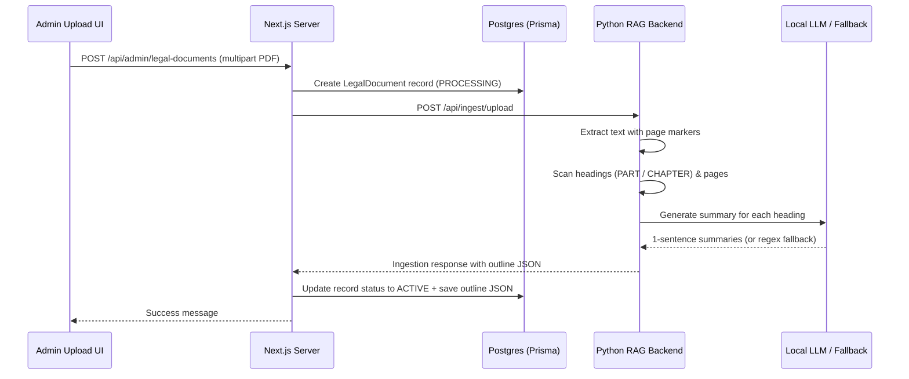

# LawyerAI AI-Generated Document Outline & Summary System Guide

This guide explains the design, data flow, and programmatic-fallback implementation of the dynamic AI-generated outlines and summaries loaded during PDF uploads.

---

## 1. Feature Context & Requirements

The Legal Library PDF viewer features a **Document Structure & Summary** sidebar column on the left. In the previous implementation, these summaries and page routes were hardcoded on the frontend client (`page.tsx`) using keyword matching on the document title. This only supported two specific documents ("criminal" and "company"), falling back to a static generic layout for any other uploaded PDF.

The updated architecture extracts the structural parts/chapters and generates concise summaries for each section **at document upload time**, storing them in a dedicated `outline` JSON field in the database.

---

## 2. Dynamic Outline Building Pipeline

The new system implements an end-to-end data flow spanning the admin upload UI, RAG backend, Postgres database, and the public legal library viewer.



---

## 3. Implementation Details

### 3.1. Text Extraction with Page Mapping
To locate the exact page numbers of legal headings, `pdf_parser.py` extracts text from PyMuPDF and prefixes each page block with a marker:
```python
all_text.append(f"--- PAGE {page_num + 1} ---\n{text}")
```
This enables the outline generator to correctly track the physical PDF page number for any matched heading by locating the nearest preceding page marker.

### 3.2. Heading Scanner and Refinement
The scanner scans page text line-by-line using regular expressions to detect Part and Chapter headings:
```python
part_pattern = re.compile(r"^\s*(PART\s+[IVXLCDM\d]+)\s*$", re.IGNORECASE)
chapter_pattern = re.compile(r"^\s*(CHAPTER\s+[IVXLCDM\d]+)\s*$", re.IGNORECASE)
```
When a match is found, the system:
1. **Lookahead Title Merging**: Looks ahead at the subsequent 1-2 lines. If they are short and represent the subtitle (e.g., "PRELIMINARY"), it merges them to form a complete title like `"CHAPTER I: PRELIMINARY Interpretation."`.
2. **Context Capturing**: Grabs the next 12 lines of text as context for summarization.
3. **Empty Context Inheritance**: If a `PART` heading has no immediate content (since it's followed directly by a `CHAPTER` heading), it automatically inherits the summary context from the subsequent `CHAPTER`.

### 3.3. Robust Summary Generation with Local LLM & Fallback
To ensure maximum reliability (especially when consumer systems experience local LLM memory allocation failures), a dual-layer summary generation approach is used:
*   **Layer 1 (Local LLM)**: Sends the heading and context to the LLM to generate a clean, 20-word, 1-sentence summary.
*   **Layer 2 (Programmatic Fallback)**: If the LLM call fails or times out, the system strips leading section numbers and truncates the captured page text context directly to `150` characters as a preview summary.

### 3.4. Database Storage Schema
The outline is saved as a JSON array of objects in the Postgres database:
```json
[
  {
    "title": "CHAPTER I: PRELIMINARY Interpretation.",
    "page": 2,
    "summary": "In this Code unless the context otherwise requires 'Attorney-General' 'Bailable offence' 'Chapter' 'Schedule' 'Section'..."
  }
]
```

### 3.5. Frontend Page Binding
In `src/app/[locale]/(public)/legal-library/[id]/page.tsx`, the client fetches the document object:
1. If the document has a saved `outline` (from the database), it renders it dynamically.
2. Clicking a section heading sets the `activePage` state, updating the PDF reader's iframe source hash to `#page={activePage}` to scroll the PDF directly to that section.
3. If no `outline` is present in the database (e.g., for legacy documents uploaded before this update), it falls back to the hardcoded outline generator, preserving full backward compatibility.
